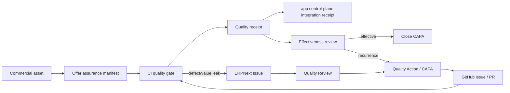

# Offer Assurance CAPA

This bounded context adds a quality gate around commercial assets without turning the repository into an ERP or duplicating the site catalogue.

## Ownership

- `copywriting` owns the commercial asset, its claims, its evidence references and its offer-quality manifest.
- ERPNext owns nonconformity, root cause, corrective/preventive action, responsibility and effectiveness review.
- GitHub owns implementation history, tests and immutable commit identity.
- CI/CD produces the technical quality receipt.
- `app.mickael-umt.com` may ingest that receipt as an integration record; it does not become the CAPA authority.
- WBNK consumes canonical commercial IDs through its existing mesh. It never becomes the writer for price, eligibility, guarantee or transaction semantics.

## Primary keys

Cross-system joins use stable business keys rather than titles:

- commercial asset: `programme.ai-production-assurance`, `offer.agentic-ai`, etc.;
- ERP CAPA: `umt_id` on `Quality Action`;
- GitHub implementation: repository + commit SHA / issue / PR URL;
- learning mesh: existing WBNK canonical IDs;
- runtime receipts: immutable `event_id` plus source repository and commit SHA.

## Value-quality decomposition

The gate treats the offer value model as five independently inspectable controls:

1. desired outcome is explicit and evidence-bounded;
2. perceived likelihood has an evidence count, evidence references and coverage;
3. full outcome delay and first verified value are explicit;
4. client effort/dependencies are explicit and false precision is forbidden;
5. risk reversal is limited to commitments the delivery system controls, with excluded outcomes stated.

The gate does **not** turn these dimensions into an invented numerical value score. Missing measurements remain `null`/`to_measure` and generate a warning or CAPA rather than a fabricated number.

## DDD and variance

`src.asset_quality.domain` is pure domain code. It imports no GitHub, ERPNext, Django or publishing adapter.

`AssetSource[T_co]` is covariant: a source of a specialised asset can satisfy a reader that accepts a base asset. `AssetRule[T_contra]` is contravariant: a validator written for the base asset can safely validate specialised assets. This lets asset types extend without copying the core invariants.

## Closed loop

A merge proves implementation. It never proves CAPA effectiveness by itself.
